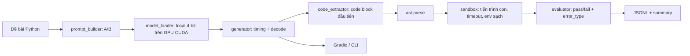

# Kiến trúc demo

## 1. Luồng dữ liệu

## 2. Vai trò module

| Module | Trách nhiệm | Không làm |
|---|---|---|
| `src/prompt_builder.py` | Tạo messages cho Prompt A/B từ `prompts/*.txt` | Không chứa đáp án/test |
| `src/model_loader.py` | Nạp Transformers/PyTorch backend `local`, 4-bit khi có CUDA; code vẫn giữ nhánh `endpoint` nhưng không dùng cho checkpoint này | Không log token |
| `src/generator.py` | Gọi model một lần, đo latency, trả text + metadata | Không tự sửa output |
| `src/code_extractor.py` | Trích code block đầu tiên, kiểm tra cú pháp | Không thực thi code |
| `src/sandbox.py` | Chạy solution + test trong tiến trình con, timeout, env sạch, giới hạn POSIX | Không chạy trong tiến trình chính |
| `src/evaluator.py` | Gom syntax/test/error_type | Không quyết định "đúng về mặt học thuật" thay test |
| `src/logging_utils.py` | Đọc config, ghi JSONL, tính pass@1/syntax validity/latency | Không chỉnh sửa bản ghi thô |
| `app/demo.py` | Gradio UI + CLI fallback | Không gọi thẳng `exec()` |
| `scripts/*` | Smoke test, benchmark, probe runtime | Không chứa secret |

## 3. Quyết định backend

Máy hiện tại: Windows 11, Python 3.13.5, PyTorch 2.10.0+cpu, CUDA unavailable, GPU 2 GB. Ổ C: chỉ ~26 GB trống nhưng workspace nằm trên ổ F: (~453 GB trống), nên **dung lượng không phải blocker**; blocker là CUDA/VRAM. Vì vậy:

1. **Đã chốt:** Colab/Kaggle GPU T4 (≥8 GB VRAM) + `local` 4-bit, giữ `Llama-3.1-8B-Instruct`. Đây là cấu hình đã chạy benchmark thật.
2. Endpoint HF Inference Providers đã được thử nhưng **loại**: checkpoint này có `inferenceProviderMapping: {}`, provider `groq` báo model không được hỗ trợ. Không dùng làm phương án dự phòng.
3. Chỉ fallback `Llama-3.2-3B/1B-Instruct` nếu cuối cùng không có GPU đáp ứng; phải ghi rõ model ID/revision và lý do. Hiện **không fallback**.

Chạy `python scripts/check_runtime.py` để in ra quyết định hiện tại dưới dạng JSON.

## 4. Giới hạn an toàn cần ghi trong báo cáo

- Mã sinh ra chạy ở tiến trình con, thư mục tạm, env đã lọc, có timeout.
- Trên POSIX có thêm RLIMIT_CPU/AS/FSIZE/NPROC; trên Windows stdlib không giới hạn RAM được — phải nêu rõ.
- Runner có import guard và audit hook (best-effort) chặn import mạng/tiến trình, tạo socket, `os.system`, và `open` ngoài miền cho phép; network **vẫn không bị cắt ở tầng OS**. Không truyền secret vào env con.
- Sandbox là giảm thiểu rủi ro cho đồ án, không phải hardening production. Guard được bổ sung sau lượt benchmark `20261127T192206Z`; nếu chạy lại phải dùng `run_id` mới, không trộn số liệu. Chi tiết: [docs/sandbox.md](sandbox.md).
