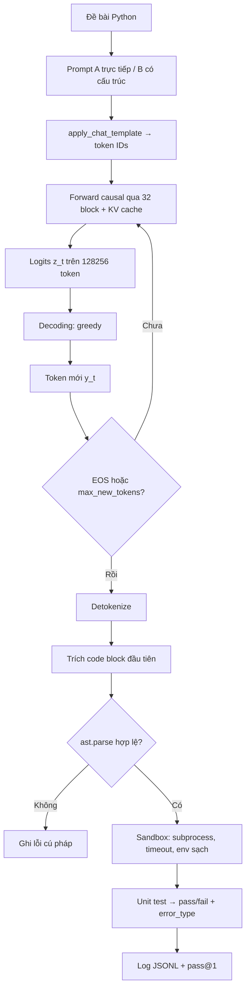

# Quy trình sinh mã từ đề bài đến kiểm thử

Pipeline của đồ án gồm hai giai đoạn: **sinh token tự hồi quy** bằng Llama và **kiểm chứng đầu ra** bằng trích xuất code, kiểm tra cú pháp và unit test trong sandbox.

## 1. Lưu đồ



Mỗi vòng lặp chỉ sinh **một token**. Token mới được nối vào ngữ cảnh; K/V của các token trước được tái dùng nhờ KV cache, nên vòng lặp quay lại forward pass chứ không tokenize lại toàn bộ prompt.

## 2. Pseudocode rút gọn

```python
messages = build_messages(task, variant)          # prompt_builder.py
input_ids = tokenizer.apply_chat_template(messages, add_generation_prompt=True).to(device)
out = model.generate(input_ids, max_new_tokens=256, do_sample=False,
                     pad_token_id=tokenizer.eos_token_id)
new_ids = out[0][input_ids.shape[-1]:]            # chỉ lấy phần mới
text = tokenizer.decode(new_ids, skip_special_tokens=True)
code = extract_code(text)                         # code_extractor.py
ok, msg = check_syntax(code)                      # ast.parse
record = evaluate(code, task)                     # evaluator.py → sandbox.py
```

## 3. Tham số giải mã đang dùng

| Tham số | Giá trị | Ý nghĩa |
|---|---|---|
| `do_sample` | `false` | Greedy decoding: luôn chọn token có xác suất lớn nhất, dễ lặp lại thí nghiệm |
| `temperature` | `0.0` | Điều chỉnh độ "sắc" của phân phối; chỉ có tác động khi `do_sample=true` |
| `top_p` | `1.0` | Nucleus sampling; `1.0` nghĩa là không cắt token nào, cũng chỉ dùng khi lấy mẫu |
| `max_new_tokens` | `256` | Số token mới tối đa, không tính prompt; quá nhỏ sẽ cắt mã |
| EOS / stop | token kết thúc của tokenizer | Dừng sinh để tránh phần giải thích lẫn vào code |

Khi so sánh hai chiến lược prompt, checkpoint, decoding config và tập bài được giữ cố định.

## 4. Ví dụ `is_even`

Đề bài: viết hàm Python `is_even(n: int) -> bool`, trả `True` nếu `n` chẵn (kể cả số âm và 0).

Prompt B nêu rõ ngôn ngữ, chữ ký hàm, trường hợp biên và định dạng: **một** code block Python, không giải thích. Sau template, cụm `is_even` có thể bị tách thành nhiều token (`is_`, `even`). Tại một bước giải mã, mô hình trả phân phối trên vocabulary; greedy chọn token đầu tiên thường là `def`, sau đó lặp đến EOS. Đầu ra sau detokenize:

```python
def is_even(n: int) -> bool:
    return n % 2 == 0
```

Test công khai kiểm tra `is_even(0)`, `is_even(7)`, `is_even(-4)`; nếu tất cả đúng, bản ghi được gắn `test_passed=true`.

> Phân phối xác suất minh họa trong báo cáo chỉ dùng để giải thích cơ chế, không phải logits thật của mô hình.

## 5. Vì sao phải kiểm thử sau khi sinh

Mã đúng cú pháp chưa chắc đúng yêu cầu: có thể sai chữ ký, trả sai kiểu, bỏ sót trường hợp biên, hoặc treo khi chạy. Vì vậy pipeline có hai lớp kiểm tra độc lập:

1. `ast.parse` — lọc lỗi cú pháp, không thực thi mã.
2. `src/sandbox.py` — chạy `solution.py` cùng unit test trong **tiến trình con riêng**, thư mục tạm, env đã lọc và có timeout (mặc định 5 giây). Trên POSIX có thêm giới hạn CPU/RAM/process; trên Windows stdlib không giới hạn RAM và network chưa bị chặn hoàn toàn.

Mã do mô hình sinh ra không bao giờ chạy trong tiến trình chính. Sandbox là biện pháp giảm thiểu rủi ro cho demo, không phải môi trường hardening production.

## 6. Module tương ứng

| Module | Vai trò |
|---|---|
| `src/prompt_builder.py` | Tạo messages cho Prompt A/B |
| `src/model_loader.py` | Nạp model/tokenizer, áp chat template, gọi `generate` |
| `src/generator.py` | Đo latency, trả text + code + metadata |
| `src/code_extractor.py` | Trích code block đầu tiên, kiểm tra cú pháp |
| `src/sandbox.py`, `src/evaluator.py` | Thực thi có giới hạn, gom `pass/fail` và `error_type` |

Tham khảo thêm: [docs/model_architecture.md](model_architecture.md), [docs/architecture.md](architecture.md).
