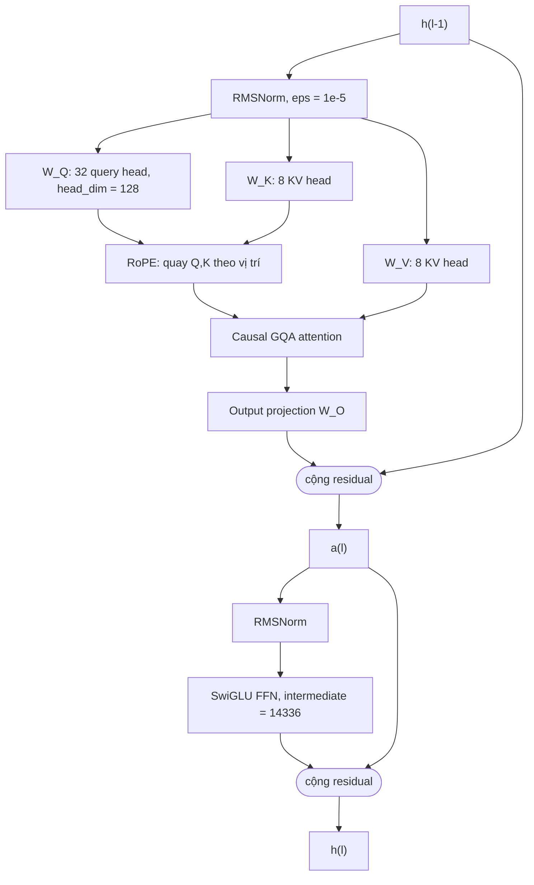
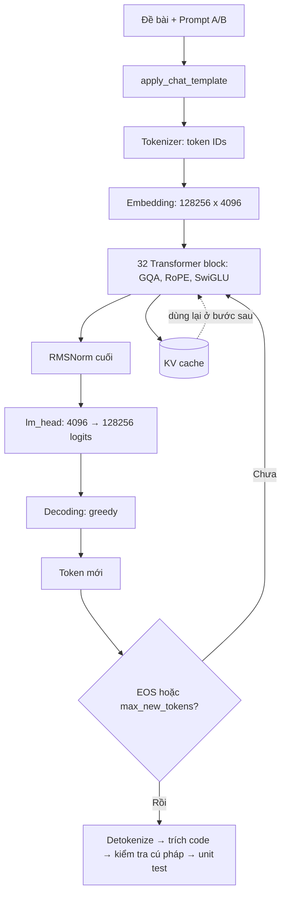

# Kiến trúc Llama 3.1 8B trong pipeline sinh mã

Mô hình dùng trong đồ án là `meta-llama/Llama-3.1-8B-Instruct`: Transformer **decoder-only dense**, dùng **GQA**, **RoPE**, **RMSNorm** và **SwiGLU**. Bài viết này mô tả luồng dữ liệu và các thông số cấu hình được dùng khi giải thích cơ chế sinh mã.

> Thông số dưới đây được đối chiếu từ hai bản `config.json` công khai của cùng checkpoint ([M1], [M2]) và model card [1]. Con số KV cache là **suy từ cấu hình**, không phải kết quả đo VRAM.

## 1. Một Transformer block

Mỗi block dùng **pre-norm**: chuẩn hóa trước Attention/FFN rồi cộng residual sau. Causal mask đảm bảo token hiện tại chỉ nhìn token trước đó. Với 32 query head và 8 KV head, **4 query head dùng chung 1 nhóm K/V** (GQA).

## 2. Toàn bộ `LlamaForCausalLM`

## 3. Thành phần và tác động tới inference

| Thành phần | Chức năng | Tác động khi suy luận |
|---|---|---|
| Tokenizer + chat template | Đề bài → token IDs, chèn role hệ thống/người dùng | Số token prompt quyết định chi phí prefill; template sai làm sinh sai định dạng [2] |
| Embedding | ID → vector 4096 chiều | Vocabulary 128256; embedding và `lm_head` không chia sẻ trọng số |
| Causal self-attention | Chỉ nhìn token trước | Bắt buộc cho sinh tuần tự |
| GQA (32/8 head) | 4 query head chia sẻ 1 KV head | Giảm KV cache khoảng 4 lần so với MHA |
| RoPE (`theta=500000`, scale llama3) | Mã hóa vị trí bằng phép quay Q/K | Cấu hình riêng của bản 3.1, hỗ trợ ngữ cảnh dài |
| RMSNorm | Chuẩn hóa RMS (`eps=1e-5`) | Ổn định tính toán; dùng trước Attention và FFN |
| SwiGLU FFN | Biến đổi phi tuyến, chiều trung gian 14336 | Phần lớn trọng số/chi phí tính toán |
| Residual + output projection | Giữ luồng thông tin; chiếu về logits | Logits của token cuối được dùng để chọn token mới |
| KV cache (`use_cache=true`) | Lưu K/V đã xử lý | Giảm tính toán mỗi bước, đổi lại bộ nhớ tăng theo chiều dài ngữ cảnh |

## 4. Cấu hình tham chiếu

| Trường | Giá trị |
|---|---|
| `architectures` | `LlamaForCausalLM` |
| `num_hidden_layers` | 32 |
| `hidden_size` / `intermediate_size` | 4096 / 14336 |
| `num_attention_heads` / `num_key_value_heads` / `head_dim` | 32 / 8 / 128 |
| `vocab_size` | 128256 |
| `max_position_embeddings` | 131072 |
| `rope_theta` | 500000 |
| `rope_scaling` | `factor=8`, `rope_type=llama3`, `original_max_position_embeddings=8192` |
| `rms_norm_eps` / `hidden_act` | `1e-5` / `silu` (SwiGLU) |
| `torch_dtype` / `use_cache` | `bfloat16` / `true` |

## 5. KV cache: ước lượng từ cấu hình

$$
\text{bytes/token}=32\ \text{lớp}\times 8\ \text{KV head}\times 128\ \text{head_dim}\times 2\,(K,V)\times 2\ \text{byte}=131\,072\ \text{byte}=128\ \text{KiB}.
$$

Ở 131072 token, riêng KV cache xấp xỉ **16 GiB** (chưa tính trọng số và activation). Con số này suy từ config, giả định 2 byte/phần tử; nó giải thích hai quyết định thực tế:

- Trọng số được nạp **4-bit NF4** để vừa VRAM GPU 16 GiB; quantization giảm kích thước trọng số, **không** làm KV cache nhỏ đi.
- Dù config khai báo `bfloat16`, trên GPU T4 (compute capability 7.5) mã nạp mô hình chuyển compute dtype sang **fp16**, nên mốc 2 byte/phần tử ở trên là phù hợp với runtime này.
- Ngữ cảnh 128k vượt VRAM T4 nếu chỉ xét riêng cache; demo vì thế giới hạn `max_new_tokens` (hiện tại 256) và không dùng ngữ cảnh tối đa.

## Nguồn

1. Llama Team, AI @ Meta (2024). *The Llama 3 Herd of Models.* arXiv:2407.21783. https://arxiv.org/abs/2407.21783
2. Meta AI (2024). *Llama 3.1 8B Instruct — Model Card.* https://huggingface.co/meta-llama/Llama-3.1-8B-Instruct ; hướng dẫn chat template: https://huggingface.co/docs/transformers/main/chat_templating
3. RoPE — Su et al. (2021), arXiv:2104.09864; RMSNorm — Zhang & Sennrich (2019), arXiv:1910.07467; SwiGLU — Shazeer (2020), arXiv:2002.05202; Attention — Vaswani et al. (2017), arXiv:1706.03762.
4. [M1] https://huggingface.co/unsloth/Meta-Llama-3.1-8B-Instruct/resolve/main/config.json ; [M2] https://huggingface.co/NousResearch/Meta-Llama-3.1-8B-Instruct/resolve/main/config.json (truy cập 28/11/2026).
