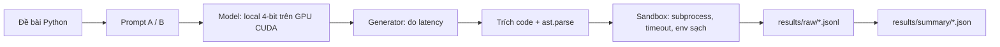

# Bản thảo báo cáo công khai — Llama cho sinh mã Python

> **Cách dùng:** số liệu trong file này được điền từ `results/summary/benchmark_20261127T192206Z.json`. Trước khi nộp cần đối chiếu với file raw từ Colab và bổ sung phân tích định tính. **Không** chép số benchmark của Llama 3/Code Llama/Llama 4 làm kết quả đo của nhóm.

## Tóm tắt

Đồ án khảo sát khả năng sinh mã Python của `meta-llama/Llama-3.1-8B-Instruct` và ảnh hưởng của chiến lược prompt. Pipeline gồm: tạo prompt (A/B) → suy luận local 4-bit trên GPU → trích xuất code block → kiểm tra cú pháp → chạy unit test trong sandbox → ghi log và tính pass@1, syntax validity, latency. Trên 35 bài `report`, cả hai prompt đạt **pass@1 = 0.914** và **syntax validity = 1.000**; prompt A nhanh hơn đáng kể (1.649 s so với 5.185 s trung bình). Giả thuyết “prompt có cấu trúc improves pass@1” **không được ủng hộ** trong lần đo này.

## 1. Đặt vấn đề

Mô hình ngôn ngữ lớn có thể sinh mã từ mô tả tự nhiên, nhưng độ tin cậy phụ thuộc cả vào mô hình lẫn cách đặt prompt. Đồ án đặt câu hỏi: với cùng một checkpoint, prompt có cấu trúc (B) có sinh ra mã chạy đúng hơn prompt trực tiếp (A) không?

## 2. Câu hỏi nghiên cứu và giả thuyết

| RQ | Câu hỏi | Giả thuyết |
|---|---|---|
| RQ1 | Llama 3.1 8B thuộc kiến trúc nào? | Decoder-only dense, GQA, RoPE, RMSNorm, SwiGLU. |
| RQ2 | Cơ chế tự hồi quy hỗ trợ sinh mã ra sao? | Attention nhân quả + KV cache tạo token tuần tự; giải thích bằng sơ đồ. |
| RQ3 | SFT/alignment tạo khả năng theo chỉ dẫn thế nào? | Bản Instruct bám chữ ký hàm tốt hơn bản base (chỉ khẳng định nếu chạy cả hai). |
| RQ4 | Prompt A/B ảnh hưởng thế nào tới pass@1? | **H1:** B cao hơn A. **H0:** không khác biệt hoặc A cao hơn. |
| RQ5 | Lỗi thường gặp và cách thực thi an toàn? | Sai chữ ký/thiếu biên/sai logic/cú pháp; cần sandbox. |

## 3. Kiến trúc và luồng dữ liệu

Chi tiết module xem `docs/architecture.md`. Mã sinh ra **không** chạy trong tiến trình chính. Trên Windows, stdlib không giới hạn RAM được và network chưa bị chặn hoàn toàn — đây là giới hạn an toàn của đồ án.

## 4. Phương pháp

| Thành phần | Cấu hình |
|---|---|
| Model | `meta-llama/Llama-3.1-8B-Instruct` @ `0e9e39f249a16976918f6564b8830bc894c89659` (revision từ checkpoint tải về) |
| Backend | `local`, 4-bit trên GPU Colab T4. Không dùng endpoint vì `inferenceProviderMapping` trống cho checkpoint này. |
| Decoding | Greedy: `temperature=0`, `top_p=1`, `max_new_tokens=256` |
| Dữ liệu | 40 bài tự biên soạn: 5 `tune` + 35 `report` |
| Prompt | A = trực tiếp; B = có vai trò, chữ ký, ràng buộc, biên, định dạng. Cùng model/decoding/task giữa hai lượt. |
| Metric | `pass@1`, `syntax_validity`, `latency_mean/median`, `error_counts` |
| Kiểm soát | Không sửa tay output; không dùng bài `tune` để tính số liệu; không đọc test ẩn khi viết prompt |

Lệnh chạy: `python scripts/check_runtime.py`, `python scripts/smoke_test.py --backend local`, `python scripts/run_benchmark.py --backend local --variants A,B`; trên Colab chạy `scripts/runtime_probe.ipynb` cell 1–8. Offline mode (`--offline`) chỉ dùng `reference_code` để validate pipeline, **không** được báo cáo.

## 5. Kết quả

Nguồn: `results/summary/benchmark_20261127T192206Z.json` — `run_id = 20261127T192206Z`, `offline = false`, 35 bài × 2 prompt = 70 bản ghi.

| Prompt | pass@1 | syntax validity | latency mean (s) | latency median (s) |
|---|---:|---:|---:|---:|
| A | 0.914 | 1.000 | 1.649 | 1.341 |
| B | 0.914 | 1.000 | 5.185 | 4.770 |

Phân loại lỗi: A gồm `none=32`, `assertion=1`, `runtime=2`; B gồm `none=32`, `runtime=2`, `name=1`. Không có lỗi cú pháp, timeout hay generation_error trong lần chạy này.

Nhận xét: H1 **không được ủng hộ** vì pass@1 bằng nhau (32/35). Trường hợp Prompt B có **độ trễ sinh** trung bình cao hơn khoảng 3,1 lần (`latency_s` chỉ đo quanh `model.generate`, không gồm sandbox; nguyên nhân có thể là output dài hơn, cần raw log để kiểm chứng) và thay đổi dạng lỗi (một lỗi `name` thay cho một lỗi `assertion`). Với 35 bài, hiệu ứng nhỏ không thể kết luận; cần nhiều sample hoặc tập lớn hơn trước khi khẳng định prompt B tốt hơn.

## 6. Thảo luận và giới hạn

- Tập 35 bài báo cáo là nhỏ; kết luận chỉ có giá trị trong phạm vi đồ án.
- Bài tự biên soạn có nguy cơ trùng với dữ liệu huấn luyện; không ngoại suy ra toàn bộ họ Llama.
- Prompt tiếng Anh trong khi đề gốc có thể tiếng Việt; cần ghi rõ nếu dịch.
- Quantization 4-bit và backend local khác với inference FP16/provider khác có thể đổi kết quả; mọi tham số được log trong từng dòng JSONL. File raw của `run_id` này cần được copy từ Colab về `results/raw/` trước khi chốt báo cáo cuối.
- `latency_s` được đo riêng quanh `model.generate`; thời gian thực thi kiểm thử nằm ở `exec_seconds`. Vì vậy **không** kết luận sandbox làm tăng latency sinh trong bảng trên. Raw log cần được export để phân tích thêm p50/p95 và độ dài output.

## 7. Kết luận

Đồ án đã chạy được pipeline thật với `meta-llama/Llama-3.1-8B-Instruct` @ `0e9e39f…` trên GPU Colab, backend local 4-bit, 35 bài đánh giá. Cả Prompt A và B đạt pass@1 = 0.914, syntax validity = 1.000; Prompt A có độ trễ thấp hơn rõ rệt. Trong giới hạn tập mẫu nhỏ và một lần lấy mẫu, không có bằng chứng Prompt B vượt Prompt A. Các bước tiếp theo là export log thô từ Colab, tăng số sample và đối chiếu lỗi định tính trước khi khóa báo cáo. Không dùng số liệu từ paper làm kết quả của nhóm.

## Tài liệu tham khảo (rút gọn)

1. Llama Team, AI @ Meta. (2024). *The Llama 3 Herd of Models.* arXiv:2407.21783.
2. Meta AI. (2024). *Llama 3.1 8B Instruct — Model Card.* Hugging Face.
3. Rozière, B. et al. (2023). *Code Llama: Open Foundation Models for Code.* arXiv:2308.12950.
4. Chen, M. et al. (2021). *Evaluating Large Language Models Trained on Code.* arXiv:2107.03374.
5. Austin, J. et al. (2021). *Program Synthesis with Large Language Models.* arXiv:2108.07732.
6. Vaswani, A. et al. (2017). *Attention Is All You Need.* arXiv:1706.03762.

> Format trích dẫn cuối cùng theo yêu cầu của giảng viên.
