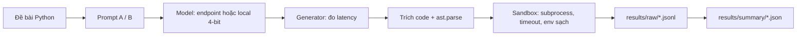

# Bản thảo báo cáo công khai — Llama cho sinh mã Python

> **Cách dùng:** file này là bản thảo để nhóm điền số liệu thật từ `results/summary/`. Các ô `TODO` phải được thay trước khi nộp. **Không** chép số benchmark của Llama 3/Code Llama/Llama 4 làm kết quả đo của nhóm.

## Tóm tắt (TODO: viết sau khi có số liệu)

Đồ án khảo sát khả năng sinh mã Python của mô hình Llama và ảnh hưởng của chiến lược prompt. Pipeline gồm: tạo prompt (A/B) → gọi mô hình → trích xuất code block → kiểm tra cú pháp → chạy unit test trong sandbox → ghi log thô và tính pass@1, syntax validity, latency. (TODO: 2–3 câu kết luận với số liệu thật.)

## 1. Đặt vấn đề

Mô hình ngôn ngữ lớn có thể sinh mã từ mô tả tự nhiên, nhưng độ tin cậy phụ thuộc cả vào mô hình lẫn cách đặt prompt. Đồ án đặt câu hỏi: với cùng một checkpoint, prompt có cấu trúc (B) có sinh ra mã chạy đúng hơn prompt trực tiếp (A) không?

## 2. Câu hỏi nghiên cứu và giả thuyết

| RQ | Câu hỏi | Giả thuyết |
|---|---|---|
| RQ1 | Llama 3.1 8B thuộc kiến trúc nào? | Decoder-only dense, GQA, RoPE, RMSNorm, SwiGLU. |
| RQ2 | Cơ chế tự hồi quy hỗ trợ sinh mã ra sao? | Attention nhân quả + KV cache tạo token tuần tự; giải thích bằng sơ đồ. |
| RQ3 | SFT/alignment tạo khả năng theo chỉ dẫn thế nào? | Bản Instruct bám chữ ký hàm tốt hơn bản base (chỉ khẳng định nếu chạy cả hai). |
| RQ4 | Prompt A/B ảnh hưởng thế nào tới pass@1? | **H1:** B cao hơn A. **H0:** không khác biệt hoặc A cao hơn. |
| RQ5 | Lỗi thường gặp và cách thực thi an toàn? | Sai chữ ký/thiếu biên/sai logic/cú pháp; cần sandbox. |

## 3. Kiến trúc và luồng dữ liệu

Chi tiết module xem `docs/architecture.md`. Mã sinh ra **không** chạy trong tiến trình chính. Trên Windows, stdlib không giới hạn RAM được và network chưa bị chặn hoàn toàn — đây là giới hạn an toàn của đồ án.

## 4. Phương pháp

| Thành phần | Cấu hình |
|---|---|
| Model | `meta-llama/Llama-3.1-8B-Instruct` @ `0e9e39f249a16976918f6564b8830bc894c89659` (TODO: ghi revision thực tế nếu fallback) |
| Backend | Endpoint (HF Inference Providers) hoặc local 4-bit trên GPU ≥8 GB (TODO: chọn một) |
| Decoding | Greedy: `temperature=0`, `top_p=1`, `max_new_tokens=256` |
| Dữ liệu | 40 bài tự biên soạn: 5 `tune` + 35 `report` |
| Prompt | A = trực tiếp; B = có vai trò, chữ ký, ràng buộc, biên, định dạng. Cùng model/decoding/task giữa hai lượt. |
| Metric | `pass@1`, `syntax_validity`, `latency_mean/median`, `error_counts` |
| Kiểm soát | Không sửa tay output; không dùng bài `tune` để tính số liệu; không đọc test ẩn khi viết prompt |

Lệnh chạy: `python scripts/check_runtime.py`, `python scripts/smoke_test.py --backend endpoint`, `python scripts/run_benchmark.py --variants A,B`. Offline mode (`--offline`) chỉ dùng `reference_code` để validate pipeline, **không** được báo cáo.

## 5. Kết quả (TODO: điền từ `results/summary/`)

| Prompt | pass@1 | syntax validity | latency mean (s) | latency median (s) |
|---|---:|---:|---:|---:|
| A | TODO | TODO | TODO | TODO |
| B | TODO | TODO | TODO | TODO |

Phân loại lỗi (TODO): `syntax=...`, `assertion=...`, `timeout=...`, `generation_error=...`, ...

Nhận xét (TODO): H1 được ủng hộ hay không? Nếu không, giải thích vì sao (prompt dài hơn, latency cao hơn, mẫu nhỏ...).

## 6. Thảo luận và giới hạn

- Tập 35 bài báo cáo là nhỏ; kết luận chỉ có giá trị trong phạm vi đồ án.
- Bài tự biên soạn có nguy cơ trùng với dữ liệu huấn luyện; không ngoại suy ra toàn bộ họ Llama.
- Prompt tiếng Anh trong khi đề gốc có thể tiếng Việt; cần ghi rõ nếu dịch.
- Provider/quantization khác nhau có thể đổi kết quả; mọi tham số được log trong từng dòng JSONL.
- Sandbox làm latency đo được cao hơn inference thuần.

## 7. Kết luận

TODO: 3–5 câu, nêu rõ model/revision, prompt hiệu quả hơn và giới hạn. Không dùng số paper làm số liệu nhóm.

## Tài liệu tham khảo (rút gọn)

1. Llama Team, AI @ Meta. (2024). *The Llama 3 Herd of Models.* arXiv:2407.21783.
2. Meta AI. (2024). *Llama 3.1 8B Instruct — Model Card.* Hugging Face.
3. Rozière, B. et al. (2023). *Code Llama: Open Foundation Models for Code.* arXiv:2308.12950.
4. Chen, M. et al. (2021). *Evaluating Large Language Models Trained on Code.* arXiv:2107.03374.
5. Austin, J. et al. (2021). *Program Synthesis with Large Language Models.* arXiv:2108.07732.
6. Vaswani, A. et al. (2017). *Attention Is All You Need.* arXiv:1706.03762.

> Format trích dẫn cuối cùng theo yêu cầu của giảng viên.
